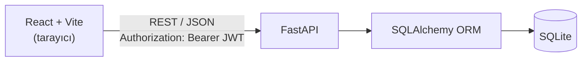
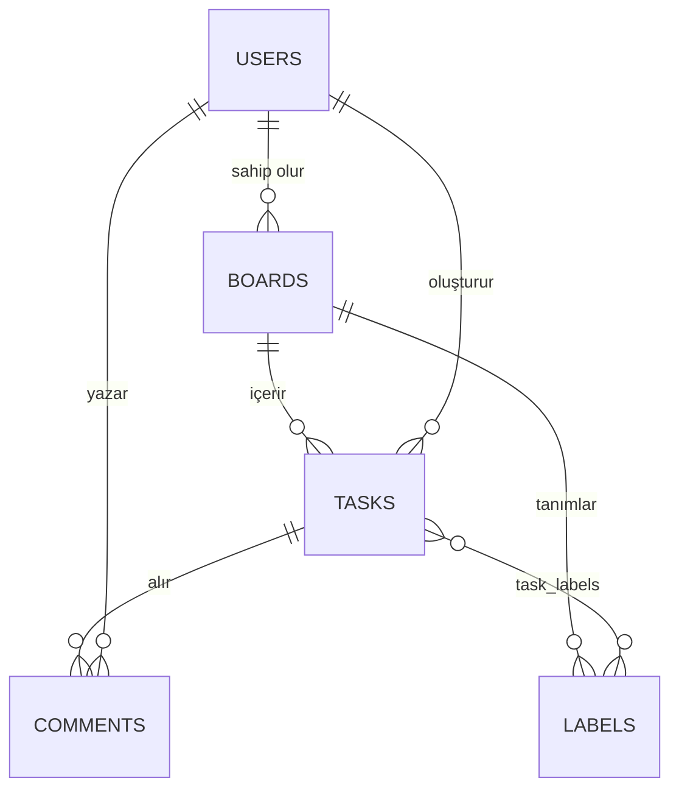

# Task Board — Kanban Görev ve Proje Takip Paneli


Trello benzeri, çoklu panolu bir görev yönetimi uygulaması. Kullanıcılar kendi panolarını oluşturur, görevlerini **Yapılacak / Devam Ediyor / Tamamlandı** sütunları arasında sürükleyerek takip eder. Backend **FastAPI**, arayüz **React** ile yazılmış, uçtan uca bir staj projesidir.

## İçindekiler

- [Özellikler](#özellikler)
- [Mimari](#mimari)
- [Veri Modeli](#veri-modeli)
- [API Özeti](#api-özeti)
- [Kurulum](#kurulum)
- [Testler](#testler)
- [Geliştirme Sürecinde Çözülen Sorunlar](#geliştirme-sürecinde-çözülen-sorunlar)
- [Yol Haritası](#yol-haritası)

## Özellikler

- **Kimlik doğrulama:** JWT tabanlı kayıt ve giriş; şifreler bcrypt ile hashlenerek saklanır
- **Çoklu pano:** Her kullanıcı kendi panolarını oluşturur, listeler ve siler
- **Kanban board:** Üç sütunlu görünüm; her sütunda görev sayısı gösterilir
- **Sürükle-bırak:** Görevler sütunlar arasında taşınır, yeni durum ve sıra backend'e kaydedilir
- **Görev yönetimi:** Başlık, açıklama, durum, öncelik (düşük / orta / yüksek) ve son teslim tarihiyle ekleme, düzenleme, silme
- **Gecikme vurgusu:** Son teslim tarihi geçmiş ve tamamlanmamış görevler kartta işaretlenir
- **İstatistik kartları:** Toplam görev, duruma göre dağılım ve tamamlanma yüzdesi
- **Profil ve ayarlar:** Ad / e-posta güncelleme, şifre değiştirme, karanlık mod, Türkçe ve İngilizce dil desteği
- **Kullanıcı geri bildirimi:** Toast bildirimleri ve özel onay pencereleri (tarayıcının varsayılan `confirm()` kutusu kullanılmaz)
- **Yetkilendirme:** Bir kullanıcı, başka birinin pano ve görevlerine API üzerinden dahi erişemez (`403`)

> Etiket (label) ve yorum (comment) için veri modeli ve API uç noktaları backend'de hazırdır; arayüz entegrasyonu [yol haritasındadır](#yol-haritası).

## Mimari



```
backend/
├── main.py          # uygulama girişi, CORS, router kayıtları
├── auth.py          # JWT üretimi/doğrulama, şifre hashleme
├── database.py      # veritabanı bağlantısı ve tablo oluşturma
├── models.py        # SQLAlchemy modelleri
├── schemas.py       # Pydantic şemaları (istek/yanıt doğrulama)
├── routers/         # auth, boards, tasks, labels, comments
└── tests/           # pytest testleri
frontend/
└── src/
    ├── api/         # axios yapılandırması (token'ı isteklere otomatik ekler)
    ├── components/  # KanbanBoard, Column, TaskCard, TaskModal ...
    ├── contexts/    # AuthContext (oturum durumu)
    └── i18n/        # TR / EN çeviri dosyaları
docs/                # geliştirme notları
```

## Veri Modeli



## API Özeti

Backend çalışırken etkileşimli dokümantasyon: **http://localhost:8000/docs**

| Grup | Uç nokta | Açıklama |
|---|---|---|
| Kimlik | `POST /auth/register` | Kayıt |
| | `POST /auth/login` | Giriş, JWT döner |
| | `GET /auth/me` | Mevcut kullanıcı |
| | `PUT /auth/profile` | Profil güncelleme |
| | `PUT /auth/change-password` | Şifre değiştirme |
| Pano | `GET` `POST /boards/` | Panoları listele / oluştur |
| | `GET` `PUT` `DELETE /boards/{id}` | Pano detayı / güncelle / sil |
| | `GET /boards/{id}/stats` | Pano istatistikleri |
| Görev | `GET` `POST /tasks/` | Görevleri listele / oluştur |
| | `GET` `PUT` `DELETE /tasks/{id}` | Görev detayı / güncelle / sil |
| | `PATCH /boards/{board_id}/tasks/{task_id}/status` | Sürükle-bırak sonrası durum güncelleme |
| Etiket | `GET` `POST /labels/`, `DELETE /labels/{id}` | Etiket yönetimi (yalnızca API) |
| Yorum | `GET` `POST /comments/`, `DELETE /comments/{id}` | Yorum yönetimi (yalnızca API) |

Korumalı uç noktalar `Authorization: Bearer <token>` başlığı gerektirir.

## Kurulum

Gereksinimler: **Python 3.10+** ve **Node.js 18+**

### 1. Backend

```bash
cd backend
python -m venv venv

# Windows
venv\Scripts\activate
# macOS / Linux
source venv/bin/activate

pip install -r requirements.txt

# Ortam değişkenleri (SECRET_KEY değerini değiştirmeyi unutmayın)
cp .env.example .env

uvicorn main:app --reload --port 8000
```

Tablolar ilk çalıştırmada otomatik oluşturulur.

### 2. Frontend

```bash
cd frontend
npm install
npm run dev
```

Uygulama: **http://localhost:5173**

## Testler

```bash
cd backend
pytest
```

14 test; kayıt/giriş, pano ve görev işlemlerini kapsar. Testler izole bir bellek içi (in-memory) veritabanı kullanır, diske dosya yazmaz.

## Geliştirme Sürecinde Çözülen Sorunlar

- **Kayıt işleminin çökmesi:** Sürümü sabitlenmemiş `bcrypt` paketi, `passlib 1.7.4` ile uyumsuzdu ve temiz kurulumda her kayıt isteği `500` hatası veriyordu. Uyumlu sürüm (`bcrypt==4.0.1`) `requirements.txt`'te sabitlenerek çözüldü.
- **Taşan/kırpılan modal:** Modal, `backdrop-filter` ve `overflow: hidden` özelliklerine sahip bir üst elemanın içinde render edildiği için `position: fixed` ekrana göre değil o elemana göre çalışıyordu. Modal, React Portal ile `document.body`'ye taşınarak çözüldü.
- **Görünmeyen giriş hatası:** Axios interceptor'ı her `401` yanıtında sayfayı yeniden yüklediği için yanlış şifrede hata mesajı gösterilemiyordu. Giriş ve kayıt istekleri bu yönlendirmenin dışında bırakıldı.
- **CORS:** İzinli origin listesi `127.0.0.1` adreslerini de kapsayacak şekilde genişletildi.
- **Test izolasyonu:** Test dosyaları birbirinin veritabanı ayarını eziyordu. Ortak bir `conftest.py` ile her test için izole bir bellek içi veritabanı kuruldu.

## Yol Haritası

- [ ] Etiket ve yorum özelliklerinin arayüz entegrasyonu
- [ ] Görev arama ve filtreleme
- [ ] `react-beautiful-dnd` yerine `@dnd-kit` geçişi (kütüphane artık bakımda değil)
- [ ] PostgreSQL desteği ve Docker ile çalıştırma

## Lisans

MIT — ayrıntılar için [LICENSE](LICENSE) dosyasına bakın.

## Geliştirici

**Ayşe Gül Çelik**